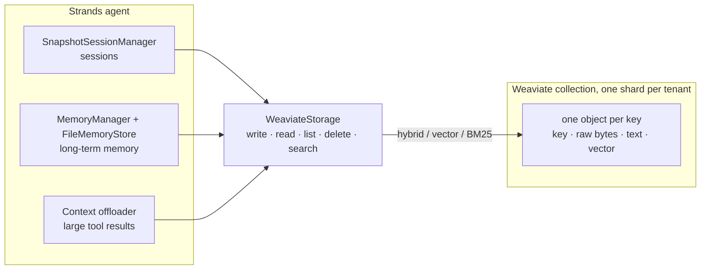

<div align="center">
  <p>
    <a href="https://weaviate.io">
      <picture>
        <source media="(prefers-color-scheme: dark)" srcset="https://weaviate.io/img/site/weaviate-logo-dark.png">
        
      </picture>
    </a>
    &nbsp;&nbsp;&nbsp;&nbsp;
    <a href="https://strandsagents.com">
      <picture>
        <source media="(prefers-color-scheme: dark)" srcset="https://strandsagents.com/latest/assets/wordmark-github-dark.svg">
        
      </picture>
    </a>
  </p>

  <h1>
    Strands Weaviate
  </h1>

  <h2>
    Sessions, memory and retrieval for Strands agents, on one Weaviate collection.
  </h2>

  <div align="center">
    <a href="https://github.com/dudanogueira/strands-weaviate/actions/workflows/ci-python.yml"></a>
    <a href="https://github.com/dudanogueira/strands-weaviate/actions/workflows/ci-typescript.yml"></a>
    <a href="LICENSE"></a>
    
    
  </div>

  <p>
    <a href="python/README.md">Python</a>
    ◆ <a href="typescript/README.md">TypeScript</a>
    ◆ <a href="examples/knowledge-agent/README.md">Example</a>
    ◆ <a href="https://strandsagents.com/">Strands docs</a>
    ◆ <a href="https://docs.weaviate.io/weaviate">Weaviate docs</a>
  </p>
</div>

**Strands Weaviate** is a [Weaviate](https://weaviate.io) backend for the
[Strands Agents](https://strandsagents.com) SDK, in Python and TypeScript. It implements the
SDK's `Storage` interface, so what a Strands agent persists through storage lands in one
Weaviate collection: session snapshots, offloaded context, and file-based agent memory. Its
`search()` is a Weaviate query (hybrid BM25 plus vector) rather than a keyword scan, so memory
recall is semantic.

```python
storage = WeaviateStorage(client)
agent = Agent(
    session_manager=SnapshotSessionManager(session_id="user-42", storage=storage),
    memory_manager=MemoryManager(stores=[FileMemoryStore(name="user", storage=storage)]),
)
```

## Why Weaviate for agent storage

- **Hybrid search built in.** Memory recall runs a Weaviate hybrid query that mixes keyword
  and vector relevance. Vectors come from a Weaviate vectorizer, from any Strands `Embedder`,
  or not at all (BM25 only).
- **Nothing goes stale.** Each key is one Weaviate object holding its bytes, its searchable
  text and its vector, so an overwrite or a delete updates all three at once.
- **Multi-tenant when you need it.** Bind a storage to a tenant and that tenant's data lives
  in its own shard. A tenant is created by its first write, never by a read.
- **Embed only what you search.** Choose which keys are made searchable (for example
  `memory/`), so session snapshots never cost an embedding call.
- **One collection, two languages.** The Python and TypeScript packages share a schema and
  derive the same object id for a key, so both SDKs can work on the same data.

## How it fits



## Quickstart

Start Weaviate locally from the repository root:

```bash
docker compose up -d
```

### Python

```bash
pip install "strands-weaviate @ git+https://github.com/dudanogueira/strands-weaviate.git#subdirectory=python"
```

```python
import weaviate
from strands import Agent
from strands.memory import MemoryManager
from strands.session import SnapshotSessionManager
from strands.vended_memory_stores import FileMemoryStore
from strands_weaviate import WeaviateStorage

client = weaviate.connect_to_local()
# Only memory entries are made searchable; sessions are stored but not embedded.
storage = WeaviateStorage(client, index_prefixes=["memory/"])

agent = Agent(
    session_manager=SnapshotSessionManager(session_id="user-42", storage=storage),
    memory_manager=MemoryManager(stores=[FileMemoryStore(name="user", storage=storage)]),
)
agent("Remember that I take my coffee with oat milk.")
```

### TypeScript

```bash
git clone https://github.com/dudanogueira/strands-weaviate.git
cd strands-weaviate/typescript && npm ci && npm pack
# then, in your project:
npm install /path/to/strands-weaviate/typescript/strands-weaviate-0.0.0.tgz @strands-agents/sdk weaviate-client
```

```ts
import weaviate from 'weaviate-client'
import { Agent, MemoryManager, SessionManager } from '@strands-agents/sdk'
import { FileMemoryStore } from '@strands-agents/sdk/vended-memory-stores/file-memory-store'
import { WeaviateStorage } from 'strands-weaviate'

const client = await weaviate.connectToLocal()
const storage = new WeaviateStorage(client, { indexPrefixes: ['memory/'] })

const agent = new Agent({
  sessionManager: new SessionManager({ sessionId: 'user-42', storage }),
  memoryManager: new MemoryManager({ stores: [new FileMemoryStore({ name: 'user', storage })] }),
})
```

Neither package is on PyPI or npm yet; both install from source as shown. The package READMEs
cover search modes, vectorizers, multi-tenancy and every option:
[Python](python/README.md) · [TypeScript](typescript/README.md).

## Try the example

[`examples/knowledge-agent`](examples/knowledge-agent/README.md) is a support agent for a
coffee roaster that runs entirely on your machine, with no API keys. Docker Compose starts
Weaviate and Ollama, `ingest.py` loads a folder of markdown, and the agent answers with a
handbook search tool and a brew-ratio calculator:

```
$ python chat.py "How much coffee do I need for 600 grams of water with pour-over?"
  -> brew_ratio(method="pour-over", water_grams=600)
For a pour-over brewing method, the recommended ratio is 1:16.7. This means you should use 36 grams of coffee for 600 grams of water.

$ python chat.py "Can I return an opened bag?"
  -> search_handbook(query="Returning an opened bag")
We cannot accept a return on an opened bag. However, if the coffee is not to your taste, you can write to us within 14 days and we will send a different one at no charge, once per customer.
```

The default chat model is a small local one (`llama3.2`), so wording varies between runs.

## Compatibility

| | Python | TypeScript |
|---|---|---|
| Package | `strands-weaviate` | `strands-weaviate` |
| Strands SDK | `strands-agents` 1.64+ | `@strands-agents/sdk` 1.25+ |
| Weaviate client | `weaviate-client` 4.17+ (sync client) | `weaviate-client` 3.15.3+ |
| Runtime | Python 3.10+ | Node.js 22+ |

Tested against Weaviate 1.40. Each package's test suite runs against an in-memory fake and,
in CI, against a real Weaviate.

## Telemetry

The packages add an `X-Weaviate-Client-Integration: strands-python/<version>` (or
`strands-typescript/<version>`) header to Weaviate requests, so Weaviate's usage telemetry
can count this integration. It carries only the integration name and version. Weaviate
servers report it only when their telemetry is on; set `DISABLE_TELEMETRY=true` on the
server to turn that off.

## Development

```bash
docker compose up -d                              # Weaviate for the integration tests

cd python && hatch run prepare                    # format, lint, type-check, unit tests
hatch run test-integ                              # the same suite against Weaviate

cd ../typescript && npm ci && npm run check       # format, lint, type-check, unit tests
npm run test:integ                                # the same suite against Weaviate
```

## License

BSD 3-Clause. See [LICENSE](LICENSE).

Community-maintained, created from the
[Strands extension template](https://github.com/strands-agents/extension-template). The
Weaviate and Strands Agents names and logos belong to their respective owners.
